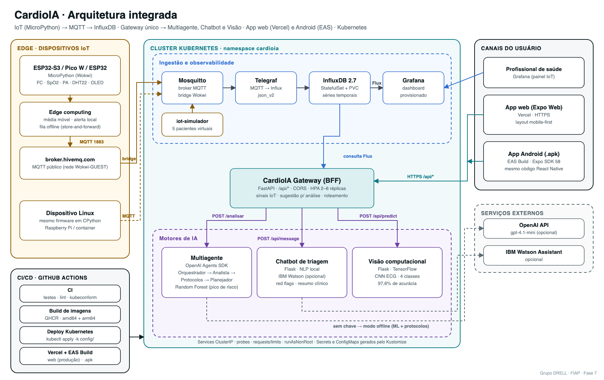
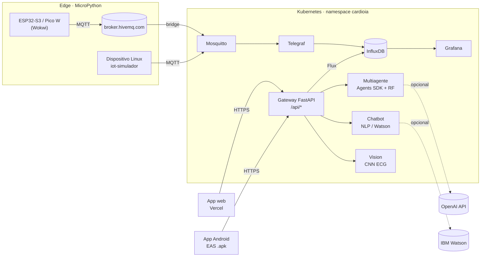

# FIAP - Faculdade de Informática e Administração Paulista

<p align="center">
<a href= "https://www.fiap.com.br/"></a>
</p>

<br>

# CardioIA · Plataforma Integrada de Monitoramento Cardiológico

## Grupo DRELL

## 👨‍🎓 Integrantes:
- <a href="https://www.linkedin.com/in/richard-marques-26b3a14/">Richard Seberino Marques</a>
- <a href="https://www.linkedin.com/in/luis-fernando-dos-santos-costa-b69894365/">Luís Fernando dos Santos Costa</a>

## 👩‍🏫 Professores:
### Tutor(a)
- <a href="https://github.com/leoruiz197">Leo Ruiz</a>
### Coordenador(a)
- <a href="https://www.linkedin.com/in/andregodoichiovato/">Andre Godoi</a>


## 🔗 Links da entrega

| Entregável | Link |
|---|---|
| App web (Vercel) | [Acesse via Web](https://cardioai-seven.vercel.app) |
| App Android (.apk via EAS Build) | [Download do APK](https://expo.dev/artifacts/eas/ExFZNPJZIaE0wZPJwwFRIU-jsQhmwESnXk7mUzJnXY8.apk) · [página do build](https://expo.dev/accounts/seberino/projects/cardioia/builds/3b23b2fb-c750-4191-8d2a-f28bf11d1c9e) |
| Simulação IoT no Wokwi (ESP32-S3) | [Link Projeto Woki](https://wokwi.com/projects/480163571338513409) |
| Vídeo de demonstração (YouTube, não listado) | [Link para o Vide no Youtube](https://youtu.be/jVXMpz86qdg) |
| Relatório técnico (PDF) | [document/relatorio_cardioia.pdf](document/relatorio_cardioia.pdf) |
| Documento do projeto (template FIAP) | [document/ai_project_document_fiap.md](document/ai_project_document_fiap.md) |


## 📜 Descrição

O **CardioIA** junta, em uma única plataforma, as soluções construídas ao longo das fases anteriores para apoiar o cuidado cardiológico. Antes, eram cinco projetos isolados: monitor IoT, visão computacional de ECG, chatbot de triagem, sistema multiagente e uma interface web com regras fixas. Agora formam um fluxo contínuo de dados, do sensor ao celular do usuário.

**Coleta (edge).** Um monitor de sinais vitais em **MicroPython** lê frequência cardíaca, SpO2, pressão sistólica e temperatura. O firmware foi reescrito com uma camada de abstração de hardware. O mesmo código roda no **ESP32**, no **ESP32-S3**, no **Raspberry Pi Pico W** (todos simulados no Wokwi) e em **Linux/CPython**, como em um Raspberry Pi ou em um container. O processamento de borda calcula médias móveis e classifica cada leitura como *normal*, *atenção* ou *crítico*, com os mesmos limites da base de protocolos clínicos. Ele também aciona alarmes locais (LEDs, buzzer e display OLED) e guarda as mensagens em uma fila quando a rede cai (*store-and-forward*).

**Ingestão.** As leituras seguem por **MQTT** até o **Mosquitto**. O **Telegraf** grava cada leitura no **InfluxDB**, e o **Grafana** exibe um painel provisionado automaticamente. O Telegraf substitui a configuração manual do Node-RED da fase anterior, então toda a infraestrutura fica declarativa e reproduzível.

**Inteligência.** Três motores de IA viraram serviços independentes:
- **Multiagente** (OpenAI Agents SDK com Random Forest): quatro agentes (Orquestrador, Analista de Risco, Especialista em Protocolos e Planejador de Resposta) transformam os dados do paciente em uma recomendação estruturada. Sem chave da OpenAI, roda em modo offline determinístico.
- **Chatbot de triagem** (NLP local ou IBM Watson): conduz a conversa, detecta sinais de alarme e gera um resumo clínico.
- **Visão computacional** (CNN em TensorFlow): classifica imagens de ECG em quatro classes, com 97,6% de acurácia.

**Integração.** Um **gateway (BFF) em FastAPI** é o único ponto de entrada. Ele consulta o InfluxDB, encaminha as requisições aos motores de IA e cria uma ligação nova entre as partes: os sinais coletados pelo IoT **pré-preenchem a análise do multiagente**, com médias recentes e episódios de alerta.

**Canais.** Um app **Expo (React Native)** com layout mobile-first tem cinco telas: sinais vitais em tempo real, análise multiagente, assistente conversacional, envio de exames de ECG e ajustes. O mesmo código gera o site publicado na **Vercel** e o **APK Android** pelo **EAS Build**.

**Operação.** Cada serviço tem um Dockerfile e uma imagem publicada no GHCR (amd64 e arm64) por pipeline. A implantação usa manifests **Kubernetes** gerenciados por Kustomize, com probes, limites de recursos, HPA, Secrets e ConfigMaps. Pipelines do GitHub Actions cobrem testes, build de imagens, deploy no cluster, publicação na Vercel e build mobile.

> Projeto acadêmico com dados sintéticos. Não substitui avaliação médica. Em emergência, ligue 192.


## 🏗 Arquitetura

<p align="center"></p>



### Componentes

| Componente | Pasta | Imagem / runtime | Porta | Papel |
|---|---|---|---|---|
| Gateway (BFF) | [src/gateway](src/gateway) | `cardioia-gateway` | 8080 | API única do app: IoT, análise, chat, ECG e saúde agregada |
| Multiagente | [src/multiagente](src/multiagente) | `cardioia-multiagente` | 8001 | Pipeline de 4 agentes + Random Forest (modo LLM ou offline) |
| Chatbot | [src/chatbot](src/chatbot) | `cardioia-chatbot` | 5000 | Triagem conversacional, red flags e resumo clínico |
| Vision | [src/vision](src/vision) | `cardioia-vision` | 5000 | CNN de ECG (4 classes), API JSON e UI de teste |
| IoT (firmware) | [src/iot](src/iot) | MicroPython / `cardioia-iot-simulador` | — | Monitor de sinais vitais com edge computing |
| App web/mobile | [src/mobile](src/mobile) | Expo SDK 58 (Vercel + EAS) | — | Interface mobile-first com 5 telas |
| Mosquitto | [config/mosquitto](config/mosquitto) | `eclipse-mosquitto:2.0.20` | 1883 / 9001 | Broker MQTT + bridge do Wokwi |
| Telegraf | [config/telegraf](config/telegraf) | `telegraf:1.34` | — | MQTT → InfluxDB |
| InfluxDB | [config/k8s](config/k8s/infra-influxdb.yaml) | `influxdb:2.7` | 8086 | Séries temporais dos sinais vitais |
| Grafana | [config/grafana](config/grafana) | `grafana/grafana:11.6.0` | 3000 | Painel de sinais vitais provisionado |

### Contrato de dados IoT

Tópico `cardioia/sinais-vitais/<paciente_id>`. Pelo Wokwi o tópico é `fiap-drell/cardioia/sinais-vitais/<paciente_id>`, que chega ao cluster pelo bridge.

```json
{"paciente_id": "PAC-WOKWI-01", "setor": "UTI_02", "dispositivo": "esp32s3-1a2b3c", "origem": "wokwi",
 "bpm": 118, "oxigenacao": 89.4, "temperatura": 37.6, "pa_sistolica": 98,
 "nivel_alerta": 1, "alerta": "ATENCAO", "motivos": "SpO2 baixa (89.4); Taquicardia (118)", "panico": 0, "seq": 42}
```

### API do gateway

| Método | Rota | Uso no app |
|---|---|---|
| GET | `/api/health` | Ajustes: estado de todos os serviços |
| GET | `/api/sinais-vitais` · `/api/sinais-vitais/{id}?minutos=` | Sinais: última leitura e série temporal |
| GET | `/api/analise/sugestao/{id}` | Análise: pré-preenche com médias do IoT |
| GET | `/api/analise/exemplos` | Análise: casos de exemplo |
| POST | `/api/analise` | Análise: executa o pipeline multiagente |
| POST | `/api/chat` · `/api/chat/reset` | Assistente: triagem ou perguntas sobre a análise (`analise_id`) |
| POST | `/api/ecg` (multipart `image`) | ECG: classificação da imagem |

Documentação interativa (OpenAPI): `http://<gateway>/api/docs`.


## 📁 Estrutura de pastas

Dentre os arquivos e pastas presentes na raiz do projeto, definem-se:

- <b>.github</b>: pipelines do GitHub Actions: `ci.yml` (testes, lint, firmware, manifests), `build-images.yml` (imagens no GHCR), `deploy-k8s.yml`, `deploy-vercel.yml` e `eas-build.yml`.

- <b>assets</b>: logo da FIAP e diagrama de arquitetura (`arquitetura.svg` / `.png`).

- <b>config</b>: configuração da infraestrutura: `kustomization.yaml` e manifests Kubernetes (`k8s/`), Mosquitto, Telegraf, provisionamento do Grafana e `.env.example`.

- <b>document</b>: documento do projeto no template FIAP, relatório em PDF e roteiro do vídeo. Na subpasta "other", material complementar (firmware legado da fase anterior).

- <b>scripts</b>: scripts auxiliares: build de imagens, deploy no Kubernetes, testes de integração, túnel HTTPS para demonstração e geração do diagrama e do PDF.

- <b>src</b>: todo o código-fonte: `gateway`, `multiagente`, `chatbot`, `vision`, `iot` e `mobile`.

- <b>docker-compose.yml</b>: stack completa para desenvolvimento local, com as mesmas imagens do Kubernetes.

- <b>README.md</b>: arquivo que serve como guia e explicação geral sobre o projeto (o mesmo que você está lendo agora).

```
.
├── .github/workflows/        ci · build-images · deploy-k8s · deploy-vercel · eas-build
├── assets/                   logo-fiap.png · arquitetura.svg/.png
├── config/
│   ├── kustomization.yaml    ponto de entrada do deploy (kubectl apply -k config/)
│   ├── k8s/                  Deployments, StatefulSet, Services, HPA, PDB, Ingress (overlay)
│   ├── mosquitto/ telegraf/ grafana/
│   └── .env.example          modelo de secrets (compose e Kubernetes)
├── document/                 ai_project_document_fiap.md · relatorio_cardioia.pdf · roteiro_video.md
├── scripts/                  build-images.sh · deploy-k8s.sh · teste-integracao.sh · expor-gateway.sh …
├── src/
│   ├── gateway/              FastAPI (BFF) + testes
│   ├── multiagente/          OpenAI Agents SDK + Random Forest + API FastAPI + testes
│   ├── chatbot/              Flask + NLP local / Watson + testes
│   ├── vision/               Flask + CNN TensorFlow (notebook de treino e API)
│   ├── iot/                  firmware MicroPython, diagramas Wokwi, simulador e testes
│   └── mobile/               app Expo (web + Android), eas.json, vercel.json
└── docker-compose.yml
```


## 🔧 Como executar o código

### Pré-requisitos

| Ferramenta | Versão usada | Para quê |
|---|---|---|
| Docker Desktop (ou Docker Engine + Compose v2) | 29.x | Imagens e stack local |
| Kubernetes (Docker Desktop, kind, k3s, minikube ou nuvem) + `kubectl` | 1.30+ | Deploy |
| Node.js | 22 LTS | App Expo |
| Python | 3.12 | Testes e execução fora do container |
| Conta Expo (EAS) e conta Vercel | — | Build mobile e publicação web |
| Conta Wokwi | — | Simulação dos dispositivos |
| Chave OpenAI (opcional) | — | Modo LLM do multiagente; sem ela, roda em modo offline |

```bash
git clone https://github.com/richardseberino/fiap_ano2_fase7_cap1.git
cd fiap_ano2_fase7_cap1
cp config/.env.example .env     # ajuste tokens/senhas; OPENAI_API_KEY é opcional
```

### Desafio 1 · Arquitetura integrada em containers e Kubernetes

**Stack local (Docker Compose):** sobe toda a infraestrutura e as aplicações com as mesmas imagens do cluster.

```bash
docker compose up -d --build
scripts/teste-integracao.sh http://localhost:8080   # 7 testes ponta a ponta
```

| Serviço | URL |
|---|---|
| Gateway / OpenAPI | http://localhost:8080/api/docs |
| Grafana (anônimo como viewer; admin/admin) | http://localhost:3000 |
| InfluxDB (fiap / fiap@1234) | http://localhost:8086 |
| UI de teste do Vision | http://localhost:5002 |
| UI original do Chatbot | http://localhost:5001 |

**Kubernetes:**

```bash
scripts/build-images.sh                 # build local (Docker Desktop compartilha as imagens com o cluster)
cp config/.env.example config/secrets.env
scripts/deploy-k8s.sh                   # kubectl apply -k config/ + espera os rollouts
```

O deploy cria o namespace `cardioia` com Mosquitto, InfluxDB (StatefulSet com PVC), Telegraf, Grafana, gateway (2 a 6 réplicas com HPA e PDB), multiagente, chatbot, vision e o simulador IoT. O acesso externo usa Services `LoadBalancer`: no Docker Desktop, `localhost:8080`, `:3000` e `:1883`; na nuvem, o IP público do balanceador. Para domínio próprio com HTTPS, use o overlay `kubectl apply -k config/k8s/ingress`, que precisa de um Ingress Controller e do cert-manager.

**Imagens publicadas pelo pipeline:** `ghcr.io/richardseberino/cardioia-{gateway,multiagente,chatbot,vision,iot-simulador}` com as tags `latest`, `sha-<commit>` e a versão semântica.

### Desafio 2 · IoT em MicroPython (Wokwi)

Instruções completas em [src/iot/README.md](src/iot/README.md). Resumo:

1. Crie um projeto MicroPython no Wokwi para a placa desejada (ESP32-S3, Pico W ou ESP32).
2. Substitua o `diagram.json` pelo de `src/iot/wokwi/<placa>/` e adicione os arquivos de `src/iot/firmware/` (`main.py`, `config.py`, `placa.py`, `edge.py`, `conectividade.py`, `compat.py`, `ssd1306.py`).
3. Rode a simulação. Os potenciômetros controlam FC, SpO2 e PA; o DHT22 controla a temperatura; o botão vermelho é o pânico. As leituras chegam ao cluster pelo bridge MQTT e aparecem no app e no Grafana em até 10 s.

O mesmo firmware roda em Linux: `cd src/iot/firmware && pip install paho-mqtt && MQTT_BROKER=localhost python main.py`.

### Desafio 3 · App web e mobile

```bash
cd src/mobile
npm ci
cp .env.example .env            # EXPO_PUBLIC_API_URL=http://localhost:8080
npx expo start --web            # navegador
npx expo start                  # Expo Go / emulador
```

- **Vercel (pipeline):** o workflow `deploy-vercel.yml` publica um preview em cada PR e a produção na `main`. Configure os secrets `VERCEL_TOKEN`, `VERCEL_ORG_ID` e `VERCEL_PROJECT_ID`, e a variável `EXPO_PUBLIC_API_URL` com a URL **HTTPS** do gateway. Na Vercel, deixe *Root Directory* vazio, porque o CLI já roda em `src/mobile`. Deploy manual: `cd src/mobile && npx vercel --prod`.
- **EAS Build (.apk):** `cd src/mobile && npx eas-cli@latest build -p android --profile preview`. Pelo pipeline, rode o workflow `eas-build.yml` (secret `EXPO_TOKEN`) ou publique uma tag `v*`. O perfil `preview` gera um APK instalável direto no celular.
- **Backend acessível da internet:** o app na Vercel é servido em HTTPS e só chama APIs HTTPS. Use o Ingress com TLS ou, para a demonstração, `scripts/expor-gateway.sh`, que abre um túnel Cloudflare `https://*.trycloudflare.com` para o gateway local. Depois, informe a URL na tela **Ajustes** do app, que fica salva no aparelho.

### Desafio 4 · Documentação

- Documento no template FIAP: [document/ai_project_document_fiap.md](document/ai_project_document_fiap.md)
- Relatório em PDF: [document/relatorio_cardioia.pdf](document/relatorio_cardioia.pdf)


### Testes automatizados

| Componente | Comando | Testes |
|---|---|---|
| Gateway | `cd src/gateway && pytest -q` | 12 |
| Multiagente (modelo, protocolos, agentes, API) | `cd src/multiagente && pytest -q` | 18 |
| Chatbot | `cd src/chatbot && pytest -q tests` | 17 |
| Firmware IoT (CPython) | `cd src/iot && pytest -q tests` | 11 |
| Firmware IoT (sintaxe MicroPython) | `mpy-cross src/iot/firmware/*.py` | 8 módulos |
| App | `cd src/mobile && npx tsc --noEmit && npx expo lint` | typecheck + lint |
| Manifests | `kubectl kustomize config/` + kubeconform | 29 recursos |
| Integração ponta a ponta | `scripts/teste-integracao.sh` | 7 |


## 🗃 Histórico de lançamentos

* 2.0.0 - 08/11/2026
    * Fase 7: plataforma integrada: gateway, containers e Kubernetes, firmware MicroPython multiplaca, app Expo (Vercel + EAS) e pipelines CI/CD
* 0.4.0 - Fase 6
    * Sistema preditivo multiagente (OpenAI Agents SDK + Random Forest)
* 0.3.0 - Fase 5
    * Assistente conversacional de triagem (IBM Watson + NLP local)
* 0.2.0 - Fase 4
    * Classificação de ECG por visão computacional (CNN e ResNet50)
* 0.1.0 - Fase 3
    * Monitor IoT em ESP32 com MQTT, Node-RED, InfluxDB e Grafana

## 📋 Licença

<p xmlns:cc="http://creativecommons.org/ns#" xmlns:dct="http://purl.org/dc/terms/"><a property="dct:title" rel="cc:attributionURL" href="https://github.com/agodoi/template">MODELO GIT FIAP</a> por <a rel="cc:attributionURL dct:creator" property="cc:attributionName" href="https://fiap.com.br">Fiap</a> está licenciado sobre <a href="http://creativecommons.org/licenses/by/4.0/?ref=chooser-v1" target="_blank" rel="license noopener noreferrer" style="display:inline-block;">Attribution 4.0 International</a>.</p>
