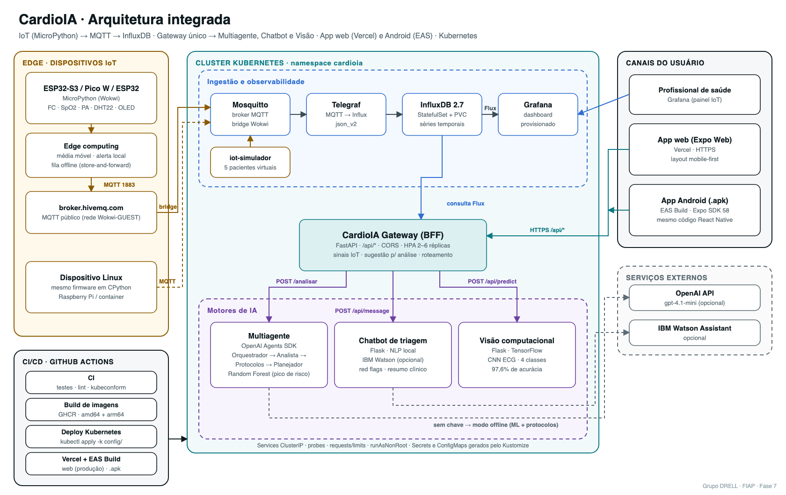
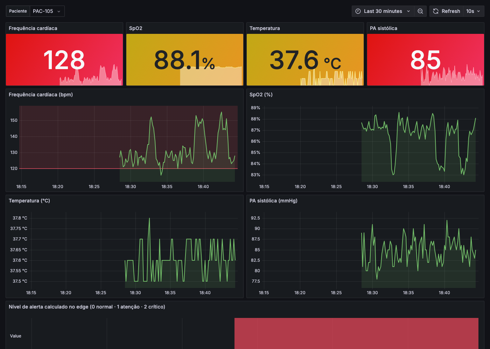
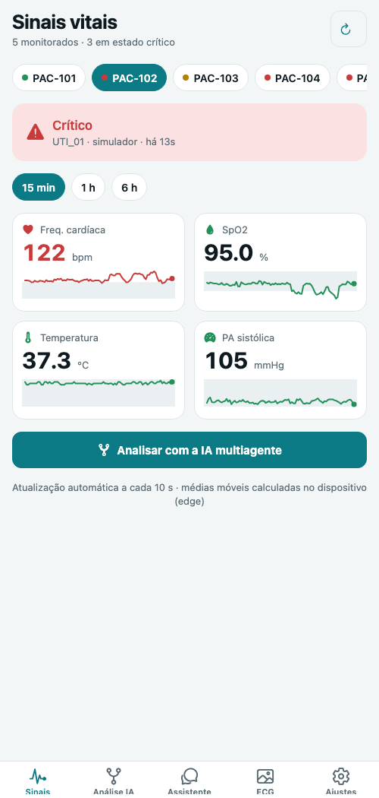
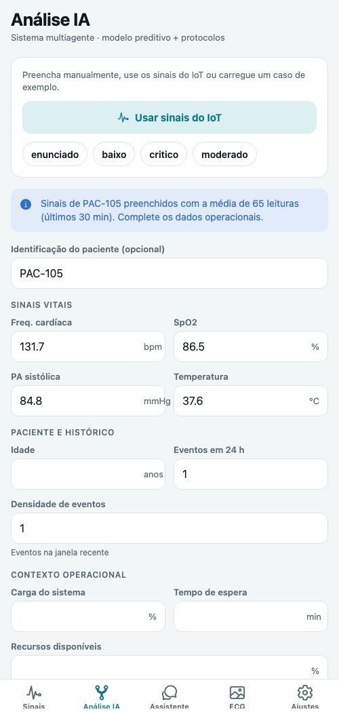
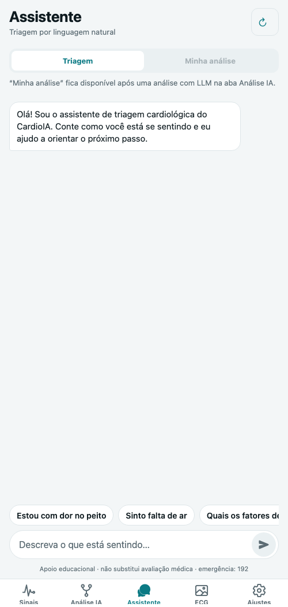
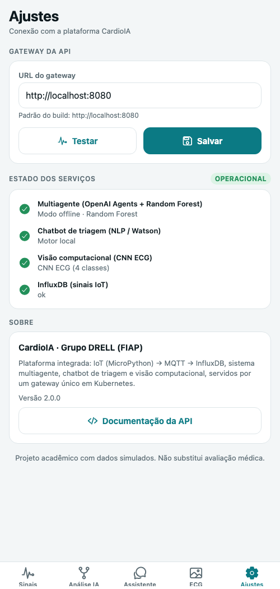

# AI Project Document - CardioIA · Plataforma Integrada de Monitoramento Cardiológico

## Grupo DRELL

#### Richard Marques · Luis Fernando dos Santos Costa

Tutor: Leo Ruiz · Coordenador: Andre Godoi · Ano 2, Fase 7

## Sumário

[1. Introdução](#c1)

[2. Visão Geral do Projeto](#c2)

[3. Desenvolvimento do Projeto](#c3)

[4. Resultados e Avaliações](#c4)

[5. Conclusões e Trabalhos Futuros](#c5)

[6. Referências](#c6)

[Anexos](#c7)

 

# 1. Introdução

## 1.1. Escopo do Projeto

### 1.1.1. Contexto da Inteligência Artificial

As doenças cardiovasculares são a principal causa de morte no Brasil e no mundo. Em serviços de urgência, o tempo entre a alteração de um sinal vital e a resposta da equipe afeta diretamente o desfecho. A IA aplicada à saúde costuma aparecer em frentes separadas: monitoramento contínuo por dispositivos IoT, modelos preditivos de deterioração, assistentes de triagem conversacional e visão computacional sobre exames de imagem. Cada frente gera valor sozinha, mas o maior ganho surge quando elas compartilham dados e aparecem para o usuário em um único canal.

Nas fases anteriores o grupo construiu cada uma dessas frentes isoladamente. O escopo desta fase é a **integração**: transformar cinco protótipos independentes em uma plataforma única, conteinerizada, implantável em Kubernetes e acessível pelo celular. O contexto é acadêmico e regional (instituições de saúde de pequeno e médio porte), com dados sintéticos.

### 1.1.2. Descrição da Solução Desenvolvida

O CardioIA integra quatro camadas:

1. **Edge:** monitor de sinais vitais em MicroPython, portável entre ESP32, ESP32-S3, Raspberry Pi Pico W e Linux. Ele calcula médias móveis, classifica a leitura e aciona alarmes localmente, e guarda as mensagens quando a rede falha.
2. **Ingestão e observabilidade:** MQTT (Mosquitto), Telegraf, InfluxDB e Grafana, todos provisionados de forma declarativa.
3. **Inteligência:** sistema multiagente (OpenAI Agents SDK com Random Forest), chatbot de triagem (NLP local ou IBM Watson) e CNN de classificação de ECG, cada um exposto como serviço HTTP.
4. **Experiência:** gateway FastAPI como ponto único de entrada e app Expo publicado como site na Vercel e como APK Android pelo EAS Build.

O valor está no fluxo contínuo. Uma leitura crítica no sensor aparece no celular em até 10 segundos e pode virar uma análise multiagente com um toque, já pré-preenchida com as médias recentes do paciente. O usuário pode então conversar com o assistente sobre o resultado ou enviar um ECG para classificação.

# 2. Visão Geral do Projeto

## 2.1. Objetivos do Projeto

| # | Objetivo | Como foi atendido |
|---|---|---|
| O1 | Organizar os subprojetos em uma arquitetura integrada | Gateway (BFF) único; contrato MQTT/JSON padronizado; o IoT alimenta a análise multiagente |
| O2 | Infraestrutura (InfluxDB, Mosquitto, Grafana) em containers | Imagens oficiais com versões fixas; configuração por arquivo (Telegraf no lugar do Node-RED manual); setup automático do InfluxDB |
| O3 | Deploy de todos os componentes em Kubernetes | Kustomize com 29 recursos: Deployments, StatefulSet com PVC, Services, HPA, PDB, Secrets, ConfigMaps e Ingress opcional |
| O4 | Uma imagem de container por aplicação | Dockerfiles para gateway, multiagente, chatbot, vision e simulador IoT; pipeline publica imagens multi-arquitetura no GHCR |
| O5 | Migrar o IoT para MicroPython portável e mais potente | Firmware modular com HAL para 4 plataformas, edge computing e fila offline; validado no Wokwi, com `mpy-cross` e testes em CPython |
| O6 | Interface mobile com sinais vitais, análise, chatbot e ECG | App Expo com 5 telas e layout mobile-first |
| O7 | Pipeline para Vercel e build EAS | Workflows `deploy-vercel.yml` (preview e produção) e `eas-build.yml` (APK) |
| O8 | Documentar no padrão FIAP | README no template, este documento, relatório em PDF e diagrama |

## 2.2. Público-Alvo

- **Equipes assistenciais** (enfermagem, médicos plantonistas): acompanham sinais vitais e alertas, executam a análise de risco e consultam as ações recomendadas.
- **Pacientes em acompanhamento:** usam o assistente de triagem para descrever sintomas e receber orientação de conduta, com encaminhamento para o 192 em caso de sinal de alarme.
- **Gestores e equipe de TI hospitalar:** operam a plataforma no Kubernetes e usam o Grafana para observar os dados.

## 2.3. Metodologia

O trabalho seguiu ciclos curtos, orientados por integração:

1. **Inventário:** leitura dos cinco projetos, com levantamento de contratos (entradas e saídas), dependências e pontos frágeis. Exemplos: modelo da CNN ausente do repositório, Node-RED configurado à mão, SpO2 simulada pela umidade do DHT22, frontend com regras estáticas.
2. **Contratos primeiro:** definição do payload MQTT, das rotas do gateway e do esquema de dados do multiagente, já validado por Pydantic.
3. **Serviços:** cada motor de IA ganhou uma API HTTP e um Dockerfile, preservando o código e os testes existentes.
4. **Integração local** com Docker Compose e testes de fumaça ponta a ponta (`scripts/teste-integracao.sh`).
5. **Kubernetes:** manifests gerados a partir de um molde comum (probes, recursos, segurança), validados com kustomize e kubeconform.
6. **App:** desenvolvimento mobile-first com Expo, verificado no navegador contra o backend real.
7. **Automação e documentação:** pipelines de CI/CD, diagrama, relatório e roteiro de demonstração.

# 3. Desenvolvimento do Projeto

## 3.1. Tecnologias Utilizadas

| Camada | Tecnologias |
|---|---|
| Edge / IoT | MicroPython (ESP32, ESP32-S3, RP2040/RP2350), `umqtt.simple`, `dht`, `framebuf`/SSD1306, CPython + paho-mqtt (Linux), Wokwi |
| Mensageria e dados | Eclipse Mosquitto 2.0, Telegraf 1.34 (`mqtt_consumer` + `json_v2`), InfluxDB 2.7 (Flux), Grafana 11.6 |
| IA | OpenAI Agents SDK 0.23 (handoffs, tools, guardrails, `SQLiteSession`), scikit-learn 1.9 (Random Forest), TensorFlow/Keras 2.21 (CNN), NLP por regras / IBM Watson Assistant |
| Backend | Python 3.12, FastAPI, Uvicorn, httpx, influxdb-client, Flask, Gunicorn, Pydantic 2 |
| Frontend | Expo SDK 58, React Native 0.88, React 19, Expo Router, react-native-svg, expo-image-picker, AsyncStorage |
| Infraestrutura | Docker / Buildx (amd64 e arm64), Docker Compose, Kubernetes 1.36, Kustomize, HPA, PDB |
| CI/CD | GitHub Actions, GHCR, Vercel CLI, EAS Build, kubeconform, mpy-cross, pytest, ESLint, TypeScript |

## 3.2. Modelagem e Algoritmos

### Arquitetura de integração

O **gateway** (padrão *Backend for Frontend*) recebe todas as chamadas do app e as roteia para os serviços internos (Services ClusterIP), que não ficam expostos. O gateway não guarda estado e escala com HPA. Os motores de IA continuam independentes: cada um tem sua imagem, seus recursos e seu ciclo de vida. A decisão permite trocar um modelo, por exemplo da CNN para a ResNet, sem afetar o restante da plataforma.

A integração nova mais relevante é **IoT → multiagente**. O endpoint `/api/analise/sugestao/{paciente}` consulta o InfluxDB, calcula as médias da janela recente (FC, SpO2, temperatura, PAS) e conta os episódios de alerta das últimas 24 h, ou seja, as transições de normal para alerta, e não cada amostra. O resultado vira os campos `eventos_24h` e `densidade_eventos` do modelo preditivo. Os campos operacionais, como carga do sistema e tempo de espera, não vêm de sensores e ficam para o usuário preencher.

### Edge computing (MicroPython)

| Técnica | Implementação | Motivo |
|---|---|---|
| Filtragem | Média móvel de 10 amostras (buffer circular) | Reduz ruído e volume transmitido |
| Classificação local | Limites de atenção e de crítico alinhados aos protocolos do multiagente | Alarme imediato e coerente com a análise central, mesmo offline |
| Publicação por evento | Período de 10 s, com envio imediato se o nível piorar ou houver pânico | Latência mínima nos eventos críticos sem saturar a rede |
| Store-and-forward | Fila limitada (60 mensagens) com número de sequência | Tolerância a falhas de conectividade |
| Portabilidade | HAL (`placa.py`) e lógica pura (`edge.py`) | O mesmo código no microcontrolador e em hardware mais potente |

### Motores de IA (reaproveitados e expostos como serviço)

- **Multiagente:** topologia *hub-and-spoke*. O Orquestrador transfere o atendimento para o Analista de Risco, que chama o Random Forest por uma *tool*; depois para o Especialista em Protocolos, que consulta a base de 10 protocolos; e por fim para o Planejador de Resposta, que produz a saída estruturada `RecomendacaoFinal`. O contexto é compartilhado, então nenhum agente digita valores clínicos. Há guardrail de entrada (bloqueia prescrição) e de saída (confere a resposta do LLM contra o contexto). A API cai automaticamente para o modo offline determinístico quando não há chave ou quando o LLM falha.
- **Chatbot:** 10 intents, 6 entities, coleta guiada por slots e 7 regras de sinal de alarme avaliadas a cada turno; resposta com classificação de risco e conduta.
- **Vision:** CNN com 3 blocos convolucionais (32, 64 e 128 filtros) sobre imagens de 224×224, classificando 4 classes de ECG.

## 3.3. Treinamento e Teste

Os modelos foram treinados nas fases anteriores e reaproveitados sem retreino:

| Modelo | Dados | Métrica principal (teste) |
|---|---|---|
| Random Forest (pico de risco) | 5.000 registros sintéticos, 10 variáveis (80/20 estratificado, validação cruzada) | Acurácia 99,9% · Precisão 100% · Recall 99,6% · ROC AUC 1,00 |
| Regressão Logística / Árvore de Decisão (comparação) | mesma base | Acurácia 81,6% / 99,7% |
| CNN do zero (ECG) | base Kaggle de ECG, 4 classes | Acurácia 97,6% · val_loss 0,0615 |
| ResNet50 com fine-tuning (comparação) | mesma base | Acurácia 84,05% |

Nesta fase o foco dos testes foi a **integração**:

| Suíte | Escopo | Resultado |
|---|---|---|
| Gateway (pytest) | roteamento, sugestão IoT → análise, chat com `analise_id`, upload de ECG, validação anti-injeção Flux | 12/12 |
| Multiagente (pytest) | modelo, protocolos, pipeline com LLM roteirizado, guardrails e API HTTP | 18/18 |
| Chatbot (pytest) | intents, entities, fluxo, emergência e fallback | 17/17 |
| Firmware (pytest em CPython) | média móvel, classificação, fila offline, ciclo do dispositivo, store-and-forward | 11/11 |
| Firmware (mpy-cross) | compilação de todos os módulos para bytecode MicroPython | 8/8 |
| App | TypeScript estrito e ESLint (regras do React Compiler) | sem erros |
| Manifests | kustomize e kubeconform (modo estrito) | 29/29 válidos |
| Ponta a ponta (compose) | saúde, IoT, série, sugestão, análise, chat e ECG pelo gateway | 7/7 |

# 4. Resultados e Avaliações

## 4.1. Análise dos Resultados

**Fluxo de dados.** Com a stack em execução, os cinco pacientes virtuais (perfis estável, taquicardia, hipoxemia, febril e choque) publicam a cada 10 s. As leituras chegam ao InfluxDB, ao Grafana e ao app (Anexo B). O paciente com perfil de choque (FC ≈ 126, SpO2 ≈ 87%, PAS ≈ 84) é classificado como **crítico** no próprio dispositivo. A análise multiagente feita com os dados sugeridos pelo IoT retornou probabilidade de pico de risco de **0,99 (ALTO)**, com 6 protocolos acionados e 6 ações operacionais priorizadas. Edge e análise central concordaram, como esperado, porque os limites foram alinhados de propósito.

**Desempenho observado (ambiente local, Apple Silicon):**

| Operação | Tempo |
|---|---|
| Sensor → app (pior caso) | ≈ 10 s, o período de envio; eventos críticos são publicados na hora |
| Análise multiagente, modo offline | < 100 ms |
| Análise multiagente, modo LLM | dezenas de segundos, conforme o modelo e a rede (timeout de 180 s no gateway) |
| Classificação de ECG (CNN, CPU) | ≈ 150 ms |
| Tamanho das imagens | gateway 302 MB · chatbot 238 MB · simulador 217 MB · multiagente 1,0 GB · vision 2,8 GB |

**Diferenças em relação ao esperado.** A imagem do vision ficou grande (2,8 GB) por causa do TensorFlow completo. Ela pode ser reduzida exportando o modelo para TFLite ou ONNX Runtime. O modo LLM depende de chave e de rede externas, e a decisão de manter o modo offline como contingência garantiu que a plataforma funcione sempre. Também foi preciso contornar uma limitação do Wokwi: a rede da simulação não alcança o cluster. A solução foi um bridge MQTT por broker público, adequado para demonstração mas não para produção.

## 4.2. Feedback dos Usuários

Não foi feita avaliação formal com usuários finais nesta fase. A verificação seguiu roteiros de uso executados pelos integrantes no navegador e no emulador:

- *Monitoramento:* identificar o paciente crítico e abrir a análise em 2 toques. Atendido, porque o app seleciona automaticamente o paciente mais grave na primeira abertura.
- *Triagem:* descrever "dor no peito forte e falta de ar". O assistente classifica como emergência e oferece **Ligar 192**.
- *Exame:* enviar uma imagem de ECG e ver a classe e as probabilidades em menos de 1 s.

Como próximo passo, propõe-se um teste de usabilidade (SUS) com profissionais de enfermagem e a coleta de métricas de uso.

# 5. Conclusões e Trabalhos Futuros

A plataforma atingiu os objetivos propostos. Os cinco projetos formam um sistema coeso, conteinerizado e implantável em Kubernetes, com um único ponto de entrada e um app que funciona na web e no Android a partir do mesmo código. O IoT foi reescrito em MicroPython portável, e os pipelines automatizam testes, imagens, deploy, publicação na Vercel e build do APK.

**Pontos fortes:** integração real entre os componentes (IoT alimentando a IA), infraestrutura declarativa e reproduzível, resiliência (modo offline do multiagente, fila offline do dispositivo, saúde agregada) e cobertura de testes em todas as camadas.

**Pontos a melhorar e plano de ação:**

| Ponto | Ação proposta |
|---|---|
| Autenticação inexistente na API e no MQTT | OIDC/JWT no gateway; MQTT com TLS (8883) e credenciais por dispositivo |
| Estado em memória (sessões do chatbot, análises para perguntas) limita réplicas | Persistir em Redis e escalar horizontalmente |
| Broker público no caminho Wokwi → cluster | Listener MQTT exposto com TLS ou Wokwi Private Gateway |
| Imagem do vision grande | Exportar o modelo para TFLite/ONNX e usar imagem *slim* |
| Observabilidade da aplicação | Métricas Prometheus e tracing OpenTelemetry nos serviços |
| Dados clínicos sintéticos | Avaliar com bases reais anonimizadas (por exemplo PTB-XL e MIMIC-IV), com aprovação ética e adequação à LGPD |
| Sensores simulados por potenciômetros | Integrar MAX30102 (FC/SpO2) e um sensor de pressão reais no ESP32-S3 |

# 6. Referências

1. ORGANIZAÇÃO MUNDIAL DA SAÚDE. *Cardiovascular diseases (CVDs) – fact sheet*. Disponível em: https://www.who.int/news-room/fact-sheets/detail/cardiovascular-diseases-(cvds).
2. OPENAI. *OpenAI Agents SDK – documentation*. Disponível em: https://openai.github.io/openai-agents-python/.
3. MICROPYTHON. *MicroPython documentation (ESP32 e RP2)*. Disponível em: https://docs.micropython.org/.
4. WOKWI. *Wokwi Docs – MicroPython e redes*. Disponível em: https://docs.wokwi.com/.
5. INFLUXDATA. *Telegraf MQTT Consumer e InfluxDB 2.x*. Disponível em: https://docs.influxdata.com/.
6. KUBERNETES. *Kubernetes Documentation – Workloads, Services, Kustomize*. Disponível em: https://kubernetes.io/docs/.
7. EXPO. *Expo Documentation – EAS Build e publicação web*. Disponível em: https://docs.expo.dev/.
8. VERCEL. *Vercel CLI e GitHub Actions*. Disponível em: https://vercel.com/docs.
9. KHAN, A. H.; HUSSAIN, M. *ECG Images dataset of Cardiac Patients*. Mendeley Data / Kaggle.
10. SOCIEDADE BRASILEIRA DE CARDIOLOGIA. *Diretrizes Brasileiras de Hipertensão Arterial*, 2020.

# Anexos

## Anexo A · Diagrama de arquitetura

## Anexo B · Evidências de execução

**Painel Grafana (paciente PAC-105, perfil choque):**

**App: sinais vitais, análise, assistente e ajustes:**

## Anexo C · Recursos Kubernetes

| Recurso | Tipo | Réplicas | Observação |
|---|---|---|---|
| mosquitto | Deployment + Service | 1 | `mosquitto-externo` (LoadBalancer 1883) para dispositivos |
| influxdb | StatefulSet + PVC 5 Gi | 1 | setup automático; token via Secret |
| telegraf | Deployment | 1 | configuração via ConfigMap |
| grafana | Deployment + Service | 1 | datasource e dashboard provisionados; `grafana-externo` |
| gateway | Deployment + Service + HPA + PDB | 2–6 | `gateway-externo` (LoadBalancer 8080) |
| multiagente / chatbot / vision | Deployment + Service | 1 | probes de startup, readiness e liveness; requests e limits; não-root |
| iot-simulador | Deployment | 1 | mesmo firmware MicroPython em CPython |
| cardioia (opcional) | Ingress com TLS | — | overlay `config/k8s/ingress` |
