> **Fase 7 · Plataforma integrada.** Este componente agora faz parte do CardioIA integrado. Arquitetura, execução com Docker Compose/Kubernetes e o app estão no [README principal](../../README.md). Novidades desta fase: API JSON `POST /api/predict` e `GET /health`, Dockerfile multi-stage que obtém o modelo treinado da imagem da Fase 4 e execução não-root.

# FIAP - Faculdade de Informática e Administração Paulista

<p align="center">
<a href= "https://www.fiap.com.br/"></a>
</p>

<br>

# Ano 2 - Fase 4

## Grupo DRELL

## 👨‍🎓 Integrantes: 
- <a href="https://www.linkedin.com/in/richard-marques-26b3a14/">Richard</a>
- <a href="https://www.linkedin.com/in/luis-fernando-dos-santos-costa-b69894365/">Luis</a>

## 👩‍🏫 Professores:
### Tutor(a) 
- <a href="https://github.com/leoruiz197">Leo Ruiz</a>
### Coordenador(a)
- <a href="https://www.linkedin.com/in/andregodoichiovato/">Andre Godoi</a>


## 📜 Descrição

Este repositório mantém os assets solicitados para esta primeira etapa da construção de um sistema inteligente de detecção de doenças cardíacas através do uso de reconhecimento visual. O processo de treinamento e escolha do melhor modelo está documentado neste repositório, bem como a interface web criada para testá-lo.

Os modelos treinados não estão inclusos no repositório devido ao seu tamanho (não permitido pelo GitHub). Porém ele está disponível (a versão CNN) embutido no container Docker (docker.io/seberino/fiap_2_4:1.0) junto com a interface de teste.

De qualquer forma todos os assets (scripts, imagens) estão disponíveis e o processo de treinamento pode ser realizado seguindo os passos no [JupyterNotebook](./entrega1.ipynb).

O treinamento de ambos os modelos (CNN e ResNet) levou em média 30 minutos cada em um computador com placa RTX 5070 dedicada. 

## Entrega 1: Treinamento de um modelo de classificação de imagens de ECG
A base de imagens de exames cardíacos foi baixada do site Kaggle, e está na pasta "assets/ECG_DATA" organizada em exemplos para treino e para teste. 
Dentro das pastas existem 4 variações de exemplos:
- Imagens de ECG de Pacientes com Infarto do Miocárdio
- Imagens de ECG de Pacientes com Histórico de Infarto do Miocárdio
- Imagens de ECG de Pacientes que possuem Batimentos Cardíacos Anormais
- Imagens de ECG de Pacientes com sinais normais

Todas as etapas desta entrega estão mapeadas e descritas (e podem ser reproduzidas) com o [JupyterNotebook](./entrega1.ipynb)


### Etapa 1.1 - Pré-processamento dos dados

Nesta etapa vamos pré-processar as imagens que foram separadas em exemplos para treino e para teste. 
As imagens originalmente possuem uma resolução de 2232 x 1572; como vamos neste exercício treinar uma rede CNN do zero e compará-la a um modelo pré-treinado (escolhemos o ResNet50), e este modelo exige imagens quadradas, escolhemos a menor resolução que não comprometesse a qualidade dos dados nas imagens. 

Executamos as seguintes ações nesta etapa:
- Redimensionamento de todas as imagens para 224 x 224, isso gera uma distorção horizontal de 29% mas não compromete o resultado
- Zeramos o parâmetro de rotação das imagens, uma vez que elas só podem ser analisadas e comparadas na horizontal 
- Normalização (valor dos pixels escalados para o intervalo [0,1])
- Conversão do formato para RGB

Segue um exemplo de como as imagens ficaram após este pré-processamento:

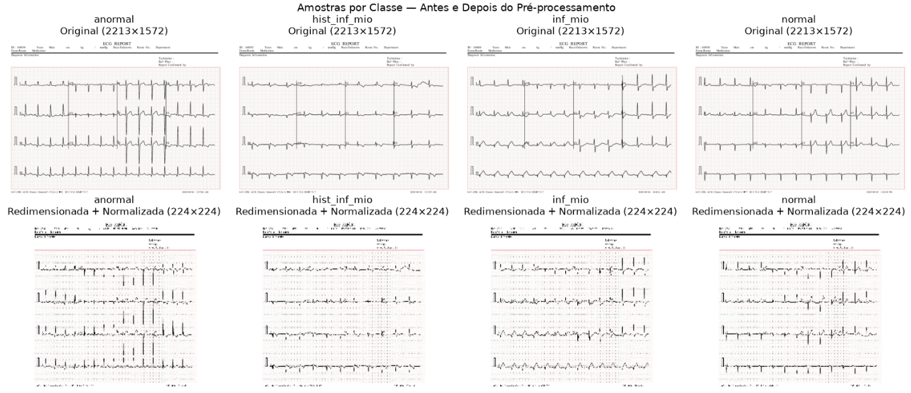 

### Etapa 1.2 - Treinamento de um modelo CNN do zero
A partir dos dados pré-processados das imagens iniciamos o treinamento de uma rede CNN do zero. Escolhemos uma arquitetura com 3 blocos convolucionais (1 com 32 filtros, segundo com 64 e o terceiro com 128 filtros). Ao final incluímos um bloco classificador. 

No treinamento, para evitar overfitting, incluímos 2 parâmetros:
- EarlyStopping = 5 para que, se a acurácia e/ou perda não melhorarem após 5 épocas seguidas, ele use os parâmetros do último treinamento estável. No caso do treino ele foi até a 24ª época, quando parou, porque na época 19 ele já alcançou o máximo possível do modelo e parou de evoluir. 
- ReduceLROnPlateau 0,5 para reduzir o passo do algoritmo conforme para de evoluir. No início "passos largos" são ótimos, mas no final faz mais sentido fazer ajustes mais finos no algoritmo.

Ao final do treinamento os valores do modelo treinado ficaram:
- Acurácia: 97,6%
- Perdas de validação (val_loss): 6,15%

Podemos validar como foi o processo de treino durante as épocas no gráfico a seguir

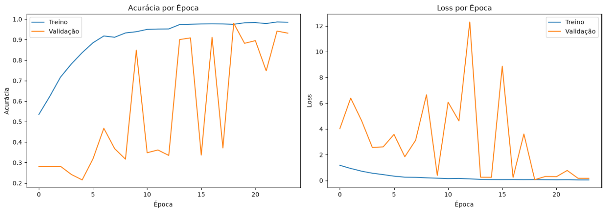 

Abaixo podemos ver as métricas de precisão e performance do modelo:

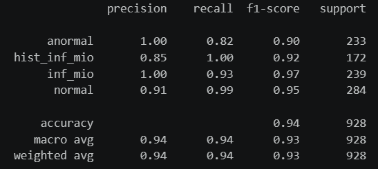 

Na matriz de confusão podemos ver com clareza como o modelo se saiu para prever / classificar novas imagens em cada uma das 4 classes em que ele foi treinado.

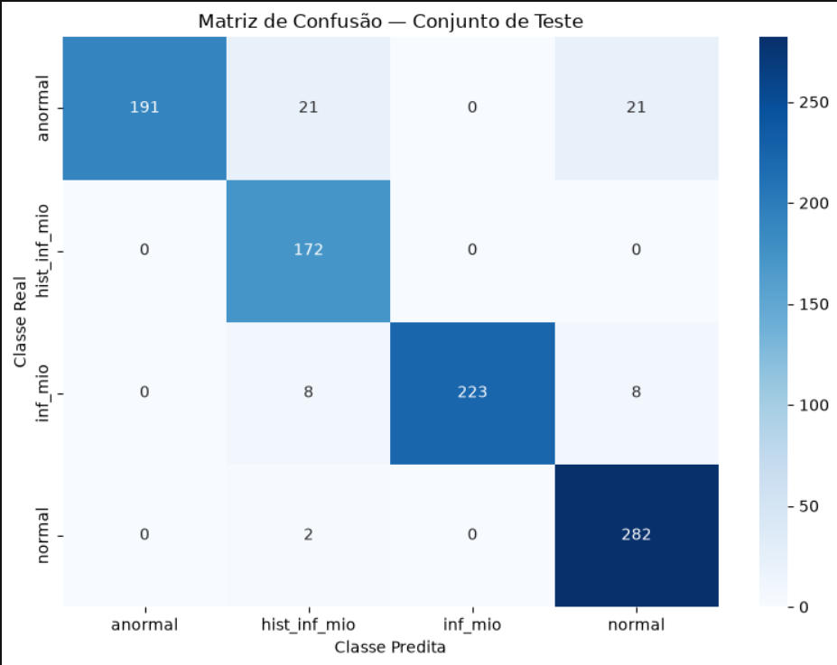 

### Etapa 1.3 - Partindo de um modelo pré-treinado (ResNet50)
Utilizamos a ResNet50 pré-treinada no ImageNet como extrator de features. A abordagem é feita em duas fases:

1. **Fase 1 — base congelada**: treina apenas o classificador adicionado no topo, mantendo todos os pesos da ResNet50 fixos.
2. **Fase 2 — fine-tuning**: descongela as últimas 20 camadas da ResNet50 e retreina com taxa de aprendizado muito menor para adaptar os features ao domínio de ECG.

O pré-processamento usa `preprocess_input` da própria ResNet50 (subtração de média por canal, escala BGR), que é diferente da normalização simples `÷255` usada na CNN do zero.

#### Fase 1 - Adicionando camadas densas ao ResNet50
Treinamos apenas as camadas densas adicionadas, sem alterar os pesos da ResNet50. Usamos LR mais alto pois os pesos aleatórios do classificador precisam convergir rapidamente.

Da mesma forma que com a CNN, usamos os parâmetros de EarlyStopping e ReduceLROnPlateau com os mesmos valores.

Aqui o modelo parou seu treinamento na época 30 (a última), porém parou de evoluir na época 25, que foi a que usamos e chegamos na performance a seguir:
- Acurácia: 77,94%
- Perdas de validação: 47,15%

#### Fase 2 - Fine-Tuning
A estratégia aqui foi descongelar as últimas 20 camadas da ResNet50 e retreiná-las com LR 100× menor para adaptar os features de alto nível ao domínio de ECG sem destruir o conhecimento pré-treinado.

Aqui o treinamento parou na época 23, mas parou de evoluir na época 18, que foi a que usamos e chegamos na performance a seguir:
- Acurácia: 84,05%
- Perdas de validação: 33,59%

#### Resumo 
Podemos avaliar como foi a evolução do treinamento do nosso modelo usando como ponto de partida o modelo pré-treinado ResNet50, os valores que chegamos só adicionando camadas extras, e os avanços adicionais retreinando suas últimas 20 camadas.

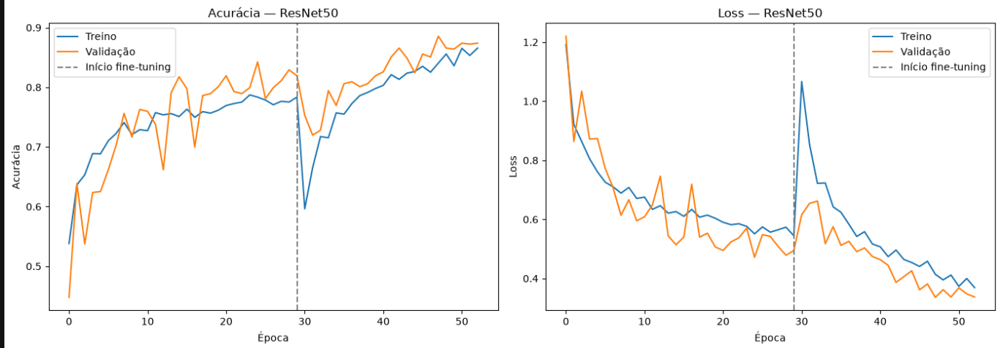 

Seguem as métricas de precisão e performance deste modelo:

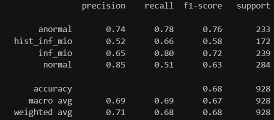 

E abaixo a matriz de confusão que nos mostra a performance do modelo ao tentar classificar novas imagens em uma das quatro classes.

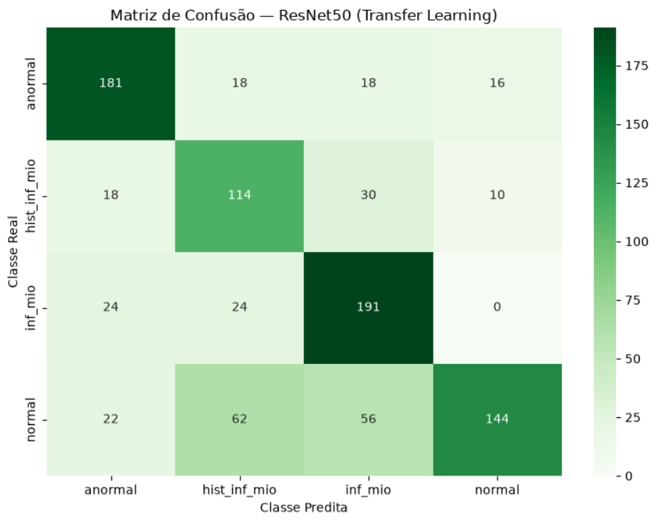 

### 1.4 - Comparação entre as 2 abordagens

Agora, depois dos testes, podemos comparar a performance das duas abordagens: o treinamento do zero de uma rede CNN ou iniciarmos com uma rede pré-treinada adicionando camadas e fazendo fine-tuning. 


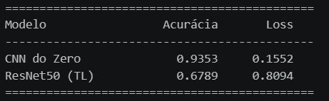 


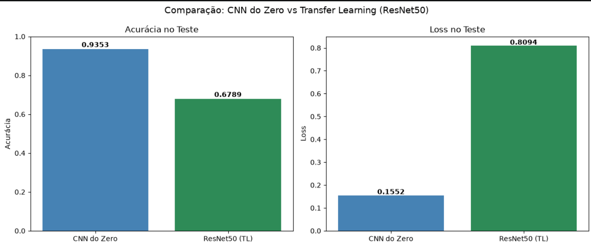 

## Entrega 2: UI para testes do modelo
Para facilitar o teste e validação do modelo, para que não seja necessário retreinar, empacotamos o modelo CNN dentro de um container com uma interface web para testes.

O código fonte desta aplicação está na pasta webapp. 

### 2.1 - Executando a UI
Para executar este app, execute o comando abaixo para iniciar o container:
```
docker run -d --name webui -p 5000:5000 seberino/fiap_2_4:1.0
```

Valide se o container está em execução com o comando a seguir:
```
docker ps 
```
O resultado do comando deve ser similar à imagem a seguir:

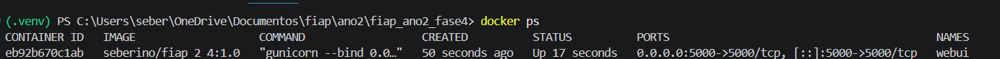 

### 2.2 - Usando a UI para testar o modelo
Para acessar e usar a interface, abra seu navegador no endereço http://localhost:5000

Uma interface como a da imagem a seguir deve abrir no seu navegador:

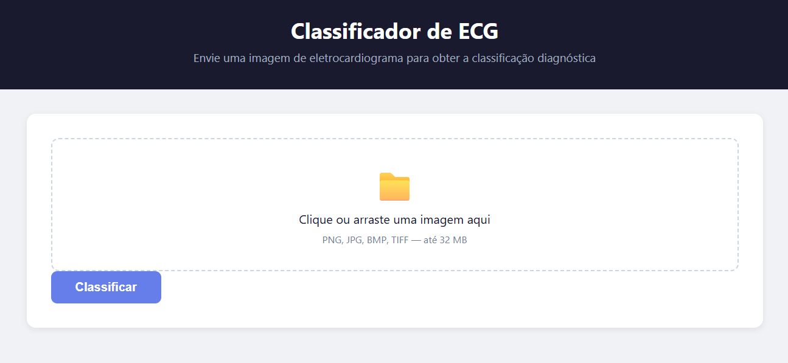 

Selecione uma imagem das pastas de teste e clique em "Classificar"

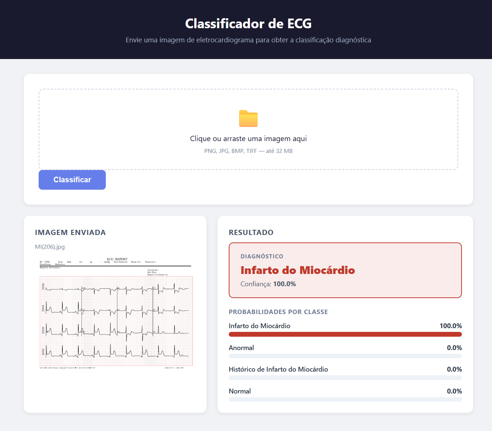 


## 📁 Estrutura de pastas

Dentre os arquivos e pastas presentes na raiz do projeto, definem-se:

- <b>assets</b>: aqui estão os arquivos relacionados a elementos não-estruturados deste repositório, como imagens.

- <b>assets/ECG_DATA</b>: Imagens para treino de modelos de IA sobre exames de ECG

- <b>doc</b>: aqui estão todos os documentos que fazem parte da entrega dos artigos científicos

- <b>README.md</b>: arquivo que serve como guia e explicação geral sobre o projeto (o mesmo que você está lendo agora).


## 🗃 Histórico de lançamentos

* 0.1.0 - 14/06/2026
    * Versão inicial

## 📋 Licença

<p xmlns:cc="http://creativecommons.org/ns#" xmlns:dct="http://purl.org/dc/terms/"><a property="dct:title" rel="cc:attributionURL" href="https://github.com/agodoi/template">MODELO GIT FIAP</a> por <a rel="cc:attributionURL dct:creator" property="cc:attributionName" href="https://fiap.com.br">Fiap</a> está licenciado sobre <a href="http://creativecommons.org/licenses/by/4.0/?ref=chooser-v1" target="_blank" rel="license noopener noreferrer" style="display:inline-block;">Attribution 4.0 International</a>.</p>

